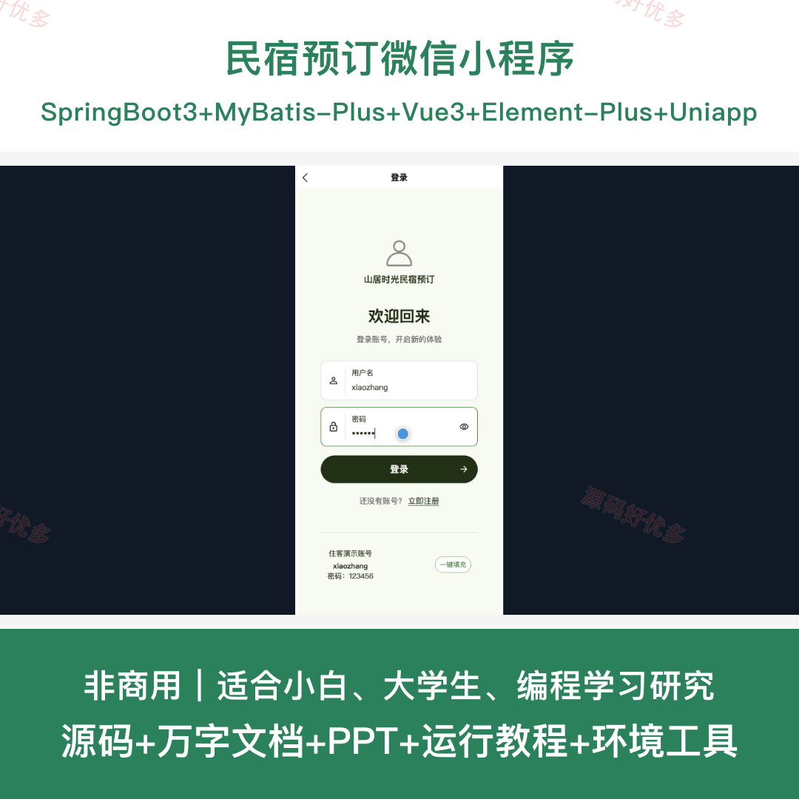
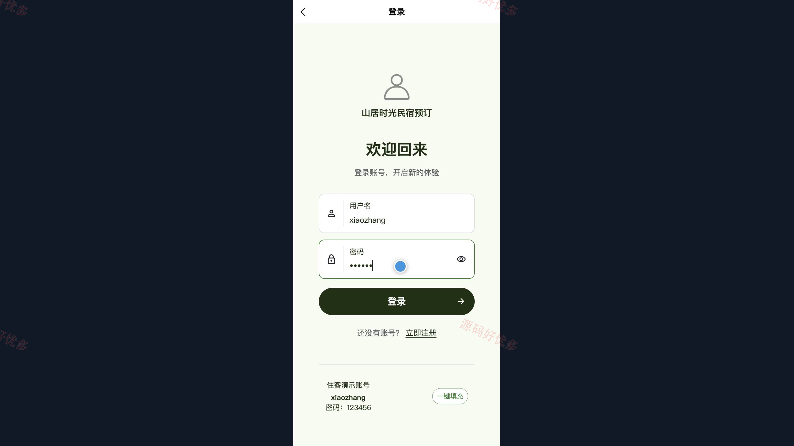
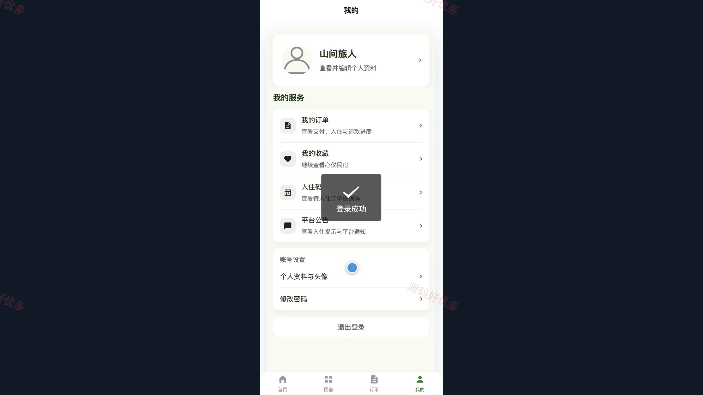
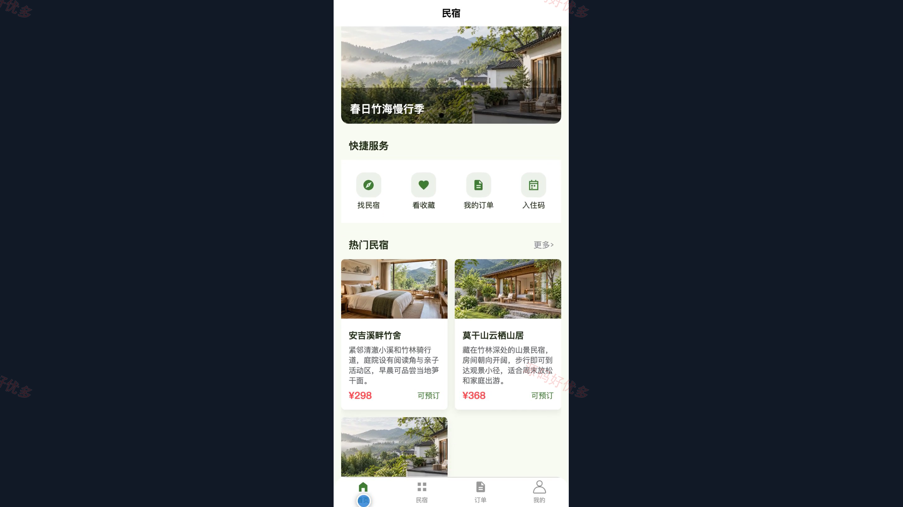
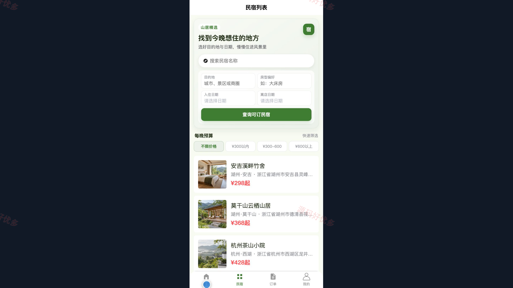
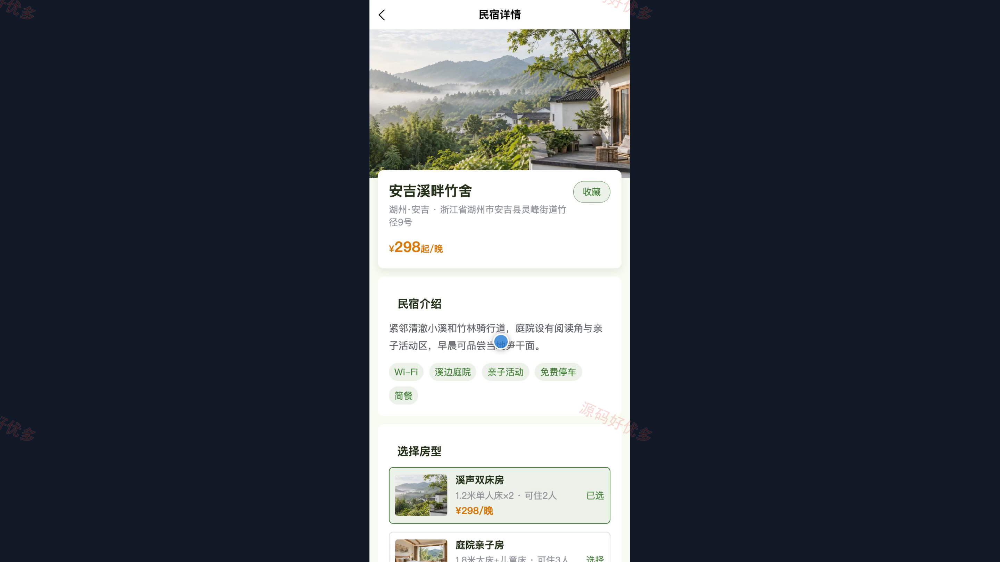
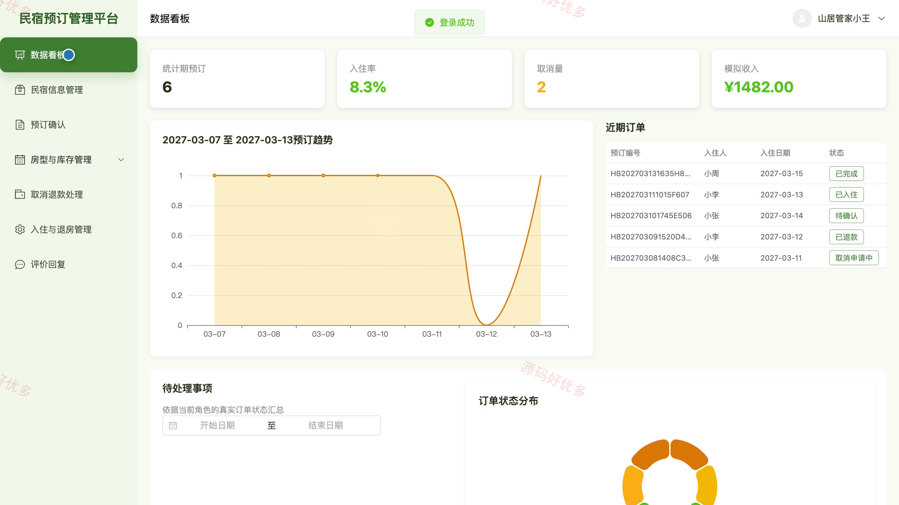
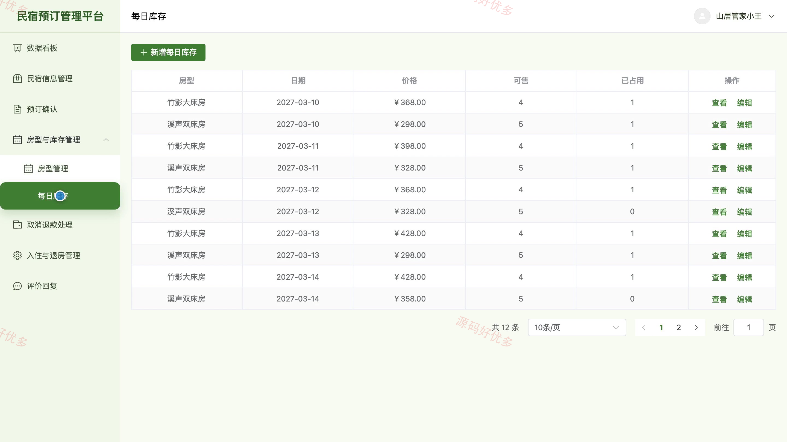
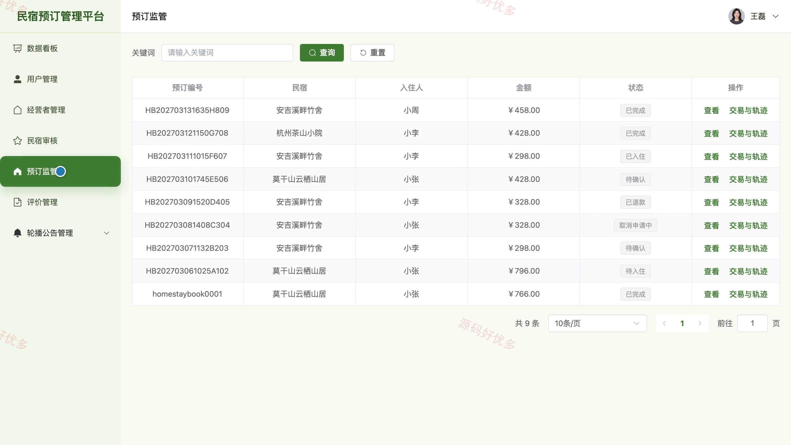

## 源码问题查看主页咨询

### 一、关键词
民宿预订、住宿预订、房型管理、入住管理、短租服务

### 二、作品包含
源码+数据库+万字设计文档+PPT+全套环境和工具资源+本地部署教程

### 三、项目技术
前端技术： Html、Css、Js、Vue3.4、Element-Plus、uniapp
后端技术：Java、SpringBoot3.2.0、MyBatis-Plus

### 四、运行环境要求
开发工具：IDEA/eclipse + VSCODE + HBuilder X + 微信开发者工具

数据库：MySQL5.7+（共14张表）

数据库管理工具：Navicat10以上版本

环境配置软件： JDK17 + Maven3.6

前端Nodejs：16+

浏览器：谷歌浏览器

### 五、项目介绍
项目编号：bs018B

民宿预订小程序为住客、民宿经营者和管理员提供分角色服务，覆盖民宿与房型浏览、在线预订、入住凭证、退款处理和评价互动。经营者负责房源、库存及订单履约，管理员负责经营者、用户、民宿审核和平台内容监管。

角色：住客、民宿经营者、管理员

住客功能：小程序登录与注册、民宿列表与详情浏览、房型选择与在线预订、预订订单查询、入住凭证查看、民宿收藏与评价、公告及个人资料维护。

民宿经营者功能：后台登录与数据看板、民宿信息管理、房型与每日库存管理、预订确认、取消退款处理、入住与退房管理、评价回复与个人资料维护。

管理员功能：后台登录与数据看板、住客与经营者管理、民宿信息审核、预订订单监管、评价内容管理、轮播图与公告管理、个人资料维护。

### 六、运行截图

